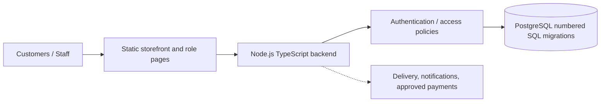

# SRC Enterprises - reverse-engineered source handover

> **Evidence:** [`bv-prasanna/SRC` / `main`](https://github.com/bv-prasanna/SRC/tree/main), source tree reviewed 10 Nov 2026. Code paths and component counts below are actual default-branch files, but **deployments, runtime behavior, successful CI and database state were not verified**.

## Architecture and trust boundary
**Technical stack:** Static web pages and Node/TypeScript API + PostgreSQL. **Business scope in repository:** storefront, internal schemes, catalogue and staff operations.

The architecture diagram reflects code families and intended wiring; it is not proof of actual cloud region, DNS, gateway, external provider credentials or release.

## Source inventory
| Domain | Matching files |
|---|---:|
| Java REST controllers | 4 |
| Java service/repository classes | 5 |
| Backend source modules | 70 |
| Frontend/API route or handler files | 2 |
| Public HTML / app page entry points | 7 |
| SQL migrations | 24 |
| Automated test source files | 24 |
| CI workflows | 3 |
| Deployment/config paths | 6 |

## API and service implementation anchors
### Java REST controllers (4)
- [`backend/src/main/java/in/srcenterprises/api/CatalogController.java`](https://github.com/bv-prasanna/SRC/blob/main/backend/src/main/java/in/srcenterprises/api/CatalogController.java)
- [`backend/src/main/java/in/srcenterprises/api/ContentController.java`](https://github.com/bv-prasanna/SRC/blob/main/backend/src/main/java/in/srcenterprises/api/ContentController.java)
- [`backend/src/main/java/in/srcenterprises/api/PromotionController.java`](https://github.com/bv-prasanna/SRC/blob/main/backend/src/main/java/in/srcenterprises/api/PromotionController.java)
- [`backend/src/main/java/in/srcenterprises/api/SchemeDraftController.java`](https://github.com/bv-prasanna/SRC/blob/main/backend/src/main/java/in/srcenterprises/api/SchemeDraftController.java)

### TypeScript/JavaScript endpoint modules (2)
- [`server/src/app.ts`](https://github.com/bv-prasanna/SRC/blob/main/server/src/app.ts)
- [`server/src/server.ts`](https://github.com/bv-prasanna/SRC/blob/main/server/src/server.ts)

### Service/repository classes (5)
- [`backend/src/main/java/in/srcenterprises/api/CatalogRepository.java`](https://github.com/bv-prasanna/SRC/blob/main/backend/src/main/java/in/srcenterprises/api/CatalogRepository.java)
- [`backend/src/main/java/in/srcenterprises/api/CategoryRepository.java`](https://github.com/bv-prasanna/SRC/blob/main/backend/src/main/java/in/srcenterprises/api/CategoryRepository.java)
- [`backend/src/main/java/in/srcenterprises/api/MediaRepository.java`](https://github.com/bv-prasanna/SRC/blob/main/backend/src/main/java/in/srcenterprises/api/MediaRepository.java)
- [`backend/src/main/java/in/srcenterprises/api/PromotionRepository.java`](https://github.com/bv-prasanna/SRC/blob/main/backend/src/main/java/in/srcenterprises/api/PromotionRepository.java)
- [`backend/src/main/java/in/srcenterprises/api/SchemeDraftRepository.java`](https://github.com/bv-prasanna/SRC/blob/main/backend/src/main/java/in/srcenterprises/api/SchemeDraftRepository.java)

### Backend modules for feature/KT lookup
- [`backend/src/main/java/in/srcenterprises/api/CatalogController.java`](https://github.com/bv-prasanna/SRC/blob/main/backend/src/main/java/in/srcenterprises/api/CatalogController.java)
- [`backend/src/main/java/in/srcenterprises/api/CatalogItem.java`](https://github.com/bv-prasanna/SRC/blob/main/backend/src/main/java/in/srcenterprises/api/CatalogItem.java)
- [`backend/src/main/java/in/srcenterprises/api/CatalogRepository.java`](https://github.com/bv-prasanna/SRC/blob/main/backend/src/main/java/in/srcenterprises/api/CatalogRepository.java)
- [`backend/src/main/java/in/srcenterprises/api/Category.java`](https://github.com/bv-prasanna/SRC/blob/main/backend/src/main/java/in/srcenterprises/api/Category.java)
- [`backend/src/main/java/in/srcenterprises/api/CategoryRepository.java`](https://github.com/bv-prasanna/SRC/blob/main/backend/src/main/java/in/srcenterprises/api/CategoryRepository.java)
- [`backend/src/main/java/in/srcenterprises/api/ContentController.java`](https://github.com/bv-prasanna/SRC/blob/main/backend/src/main/java/in/srcenterprises/api/ContentController.java)
- [`backend/src/main/java/in/srcenterprises/api/InventoryItem.java`](https://github.com/bv-prasanna/SRC/blob/main/backend/src/main/java/in/srcenterprises/api/InventoryItem.java)
- [`backend/src/main/java/in/srcenterprises/api/MediaContent.java`](https://github.com/bv-prasanna/SRC/blob/main/backend/src/main/java/in/srcenterprises/api/MediaContent.java)
- [`backend/src/main/java/in/srcenterprises/api/MediaRepository.java`](https://github.com/bv-prasanna/SRC/blob/main/backend/src/main/java/in/srcenterprises/api/MediaRepository.java)
- [`backend/src/main/java/in/srcenterprises/api/Promotion.java`](https://github.com/bv-prasanna/SRC/blob/main/backend/src/main/java/in/srcenterprises/api/Promotion.java)
- [`backend/src/main/java/in/srcenterprises/api/PromotionController.java`](https://github.com/bv-prasanna/SRC/blob/main/backend/src/main/java/in/srcenterprises/api/PromotionController.java)
- [`backend/src/main/java/in/srcenterprises/api/PromotionRepository.java`](https://github.com/bv-prasanna/SRC/blob/main/backend/src/main/java/in/srcenterprises/api/PromotionRepository.java)
- [`backend/src/main/java/in/srcenterprises/api/SchemeDraft.java`](https://github.com/bv-prasanna/SRC/blob/main/backend/src/main/java/in/srcenterprises/api/SchemeDraft.java)
- [`backend/src/main/java/in/srcenterprises/api/SchemeDraftController.java`](https://github.com/bv-prasanna/SRC/blob/main/backend/src/main/java/in/srcenterprises/api/SchemeDraftController.java)
- [`backend/src/main/java/in/srcenterprises/api/SchemeDraftRepository.java`](https://github.com/bv-prasanna/SRC/blob/main/backend/src/main/java/in/srcenterprises/api/SchemeDraftRepository.java)
- [`backend/src/main/java/in/srcenterprises/api/SecurityConfig.java`](https://github.com/bv-prasanna/SRC/blob/main/backend/src/main/java/in/srcenterprises/api/SecurityConfig.java)
- [`backend/src/main/java/in/srcenterprises/api/SrcApplication.java`](https://github.com/bv-prasanna/SRC/blob/main/backend/src/main/java/in/srcenterprises/api/SrcApplication.java)
- [`backend/src/test/java/in/srcenterprises/api/CatalogCrudTest.java`](https://github.com/bv-prasanna/SRC/blob/main/backend/src/test/java/in/srcenterprises/api/CatalogCrudTest.java)
- [`backend/src/test/java/in/srcenterprises/api/CatalogSecurityTest.java`](https://github.com/bv-prasanna/SRC/blob/main/backend/src/test/java/in/srcenterprises/api/CatalogSecurityTest.java)
- [`backend/src/test/java/in/srcenterprises/api/ContentControllerTest.java`](https://github.com/bv-prasanna/SRC/blob/main/backend/src/test/java/in/srcenterprises/api/ContentControllerTest.java)
- [`backend/src/test/java/in/srcenterprises/api/PromotionTest.java`](https://github.com/bv-prasanna/SRC/blob/main/backend/src/test/java/in/srcenterprises/api/PromotionTest.java)
- [`backend/src/test/java/in/srcenterprises/api/SchemeDraftTest.java`](https://github.com/bv-prasanna/SRC/blob/main/backend/src/test/java/in/srcenterprises/api/SchemeDraftTest.java)
- [`server/src/access.ts`](https://github.com/bv-prasanna/SRC/blob/main/server/src/access.ts)
- [`server/src/agents.ts`](https://github.com/bv-prasanna/SRC/blob/main/server/src/agents.ts)
- [`server/src/app.ts`](https://github.com/bv-prasanna/SRC/blob/main/server/src/app.ts)
- [`server/src/billing-admin.ts`](https://github.com/bv-prasanna/SRC/blob/main/server/src/billing-admin.ts)
- [`server/src/billing.ts`](https://github.com/bv-prasanna/SRC/blob/main/server/src/billing.ts)
- [`server/src/bootstrap-superadmin.ts`](https://github.com/bv-prasanna/SRC/blob/main/server/src/bootstrap-superadmin.ts)
- [`server/src/commerce.ts`](https://github.com/bv-prasanna/SRC/blob/main/server/src/commerce.ts)
- [`server/src/content.ts`](https://github.com/bv-prasanna/SRC/blob/main/server/src/content.ts)
- [`server/src/festival.ts`](https://github.com/bv-prasanna/SRC/blob/main/server/src/festival.ts)
- [`server/src/fulfillment.ts`](https://github.com/bv-prasanna/SRC/blob/main/server/src/fulfillment.ts)
- [`server/src/identity.ts`](https://github.com/bv-prasanna/SRC/blob/main/server/src/identity.ts)
- [`server/src/inventory.ts`](https://github.com/bv-prasanna/SRC/blob/main/server/src/inventory.ts)
- [`server/src/jwt.ts`](https://github.com/bv-prasanna/SRC/blob/main/server/src/jwt.ts)
- [`server/src/migrate.ts`](https://github.com/bv-prasanna/SRC/blob/main/server/src/migrate.ts)
- [`server/src/orders.ts`](https://github.com/bv-prasanna/SRC/blob/main/server/src/orders.ts)
- [`server/src/paidOrders.ts`](https://github.com/bv-prasanna/SRC/blob/main/server/src/paidOrders.ts)
- [`server/src/pan-security.ts`](https://github.com/bv-prasanna/SRC/blob/main/server/src/pan-security.ts)
- [`server/src/promote-admin.ts`](https://github.com/bv-prasanna/SRC/blob/main/server/src/promote-admin.ts)
- [`server/src/recover-superadmin.ts`](https://github.com/bv-prasanna/SRC/blob/main/server/src/recover-superadmin.ts)
- [`server/src/recovery.ts`](https://github.com/bv-prasanna/SRC/blob/main/server/src/recovery.ts)
- [`server/src/scheme-followups.ts`](https://github.com/bv-prasanna/SRC/blob/main/server/src/scheme-followups.ts)
- [`server/src/scheme-management.ts`](https://github.com/bv-prasanna/SRC/blob/main/server/src/scheme-management.ts)
- [`server/src/scheme-payments.ts`](https://github.com/bv-prasanna/SRC/blob/main/server/src/scheme-payments.ts)
- [`server/src/schemes.ts`](https://github.com/bv-prasanna/SRC/blob/main/server/src/schemes.ts)
- [`server/src/sections.ts`](https://github.com/bv-prasanna/SRC/blob/main/server/src/sections.ts)
- [`server/src/seed-demo.ts`](https://github.com/bv-prasanna/SRC/blob/main/server/src/seed-demo.ts)
- [`server/src/server.ts`](https://github.com/bv-prasanna/SRC/blob/main/server/src/server.ts)
- [`server/src/staff-access.ts`](https://github.com/bv-prasanna/SRC/blob/main/server/src/staff-access.ts)
- [`server/src/workspaces.ts`](https://github.com/bv-prasanna/SRC/blob/main/server/src/workspaces.ts)

## UI screen entrypoints
- [`admin.html`](https://github.com/bv-prasanna/SRC/blob/main/admin.html)
- [`agent.html`](https://github.com/bv-prasanna/SRC/blob/main/agent.html)
- [`customer.html`](https://github.com/bv-prasanna/SRC/blob/main/customer.html)
- [`index.html`](https://github.com/bv-prasanna/SRC/blob/main/index.html)
- [`operations.html`](https://github.com/bv-prasanna/SRC/blob/main/operations.html)
- [`scheme-admin.html`](https://github.com/bv-prasanna/SRC/blob/main/scheme-admin.html)
- [`scheme-register.html`](https://github.com/bv-prasanna/SRC/blob/main/scheme-register.html)

## Data model and ER
Authoritative source is versioned SQL in the repo; Postgres Flyway history applies for the Java services; SRC uses its Node migration runner.
- **SQL source count:** 24. [ER, schema and migration catalog](SCHEMA_INDEX.md) (source-derived; not physical deployed schema).
- Runtime data dictionary acceptance requires a read-only schema export, verified target identifier, migration history/checksums and DBA comparison of FK/indexes/views/triggers.
- Protect organization/tenant and role boundaries at the server; record database backups and test restoration before business UAT.
- **Regulated activity:** online fireworks ordering, subscriptions/mandates and processor acceptance require separate specialist legal/provider clearance. Do not interpret a schema or UI screen as authorization.

## Deployment configuration and CI
**Available package.json scripts:**
- `npm run dev`: `tsx watch src/server.ts`
- `npm run build`: `tsc`
- `npm run start`: `node dist/server.js`
- `npm run test`: `node --import tsx --test src/app.test.ts src/orders.test.ts src/schemes.test.ts src/sections.test.ts src/inventory.test.ts src/identity.test.ts src/fu`
- `npm run promote-admin`: `tsx src/promote-admin.ts`
- `npm run coverage`: `node --experimental-test-coverage --import tsx --test src/app.test.ts src/orders.test.ts src/schemes.test.ts src/sections.test.ts src/inventory.test.t`
- `npm run test:integration`: `node --import tsx --test src/integration.test.ts`
- `npm run migrate`: `tsx src/migrate.ts`
- `npm run seed:demo`: `tsx src/seed-demo.ts`
- `npm run bootstrap:superadmin`: `tsx src/bootstrap-superadmin.ts`
- `npm run recover:superadmin`: `tsx src/recover-superadmin.ts`

**Deployment/secret configuration files:**
- [`_headers`](https://github.com/bv-prasanna/SRC/blob/main/_headers)
- [`backend/.env.example`](https://github.com/bv-prasanna/SRC/blob/main/backend/.env.example)
- [`public/_headers`](https://github.com/bv-prasanna/SRC/blob/main/public/_headers)
- [`render.yaml`](https://github.com/bv-prasanna/SRC/blob/main/render.yaml)
- [`server/.env.example`](https://github.com/bv-prasanna/SRC/blob/main/server/.env.example)
- [`server/Dockerfile`](https://github.com/bv-prasanna/SRC/blob/main/server/Dockerfile)

**CI/release workflows:**
- [`.github/workflows/backend-verify.yml`](https://github.com/bv-prasanna/SRC/blob/main/.github/workflows/backend-verify.yml)
- [`.github/workflows/node-verify.yml`](https://github.com/bv-prasanna/SRC/blob/main/.github/workflows/node-verify.yml)
- [`.github/workflows/static-check.yml`](https://github.com/bv-prasanna/SRC/blob/main/.github/workflows/static-check.yml)
**Operator release sequence:** pin SHA and generated build; apply migration only with reviewed version history, staging backup & restore, no production seeding, role/negative tests, health/correlation logs; promote approved artifact, verify live data and reconcile financial transactions if applicable.

## Maintenance and KT
1. Show user, role/admin and error/success states using synthetic or UAT data, not customer PII.
2. Trace UI -> controller/API -> service -> persisted entity/migration via linked source, documenting any features still only placeholders.
3. Show full build, CI job, deployments, logs/metrics, alerts, DB migration and tested restore, then rollback protocol.
4. Negative tests: invalid or expired auth, forbidden roles, bad payload, payment webhook replay, retries/duplicate requests, unavailable database, missing file/geo evidence and data leakage.
5. Sign off with exact deployed SHA, cloud hostnames, backup reference, runtime schema, CI evidence, defect backlog and on-call owner.

**Existing guides:** [Architecture/deployment/KT](README.md) · [Schema/ER](SCHEMA_INDEX.md) · [safe migration operator script](migrate-safe.sh).

**Caveat:** Filename categorization does not prove a route is mounted, an endpoint is accessible, tests pass or any third-party integration is live. Validate with running application and source controls during UAT.

## Runtime selection from actual Render blueprint (10 Nov 2026)

The repository includes both a legacy `backend/` Java source tree and the active-looking `server/` Node/TypeScript implementation. The [`render.yaml`](../../render.yaml) selects **`./server/Dockerfile`**, `/ready` health check and `server/src/server.ts`-based API through its Docker image. **Do not describe the Java backend as the deployed production API merely because its controllers exist.**

The blueprint specifies a **staging/UAT free Render service** in Singapore, with the public storefront proposed at Cloudflare Pages and API custom subdomain `api.srcenterprises.in`. These settings are a deployment proposal, **not verification** that the service is currently running.

**Critical defaults:** `SRC_PAYMENTS_ENABLED=false`, `SRC_SCHEME_SUBSCRIPTIONS_ENABLED=false`, and `DATABASE_URL`, `SRC_JWT_SECRET`, `SRC_PAN_ENCRYPTION_KEY` supplied as secrets. The server entrypoint enforces a configured database URL, 48-byte minimum JWT secret and additional live-payment prerequisites. Never enable regulated payment or scheme flows solely for UAT; require legal and payment-provider written clearance, plus finance/security testing.

For KT, show `render.yaml` → `server/Dockerfile` → `server/src/server.ts` → application routes → PostgreSQL numbered migrations; separately identify legacy Java as reference/unverified runtime. Validate the actual deployment SHA and readiness check before calling it live.
