# SRC Enterprises PostgreSQL schema: Part 1

> SQL files 1–11 of 21, default branch `main`, 2026-11-09. Source-derived; not verified actual database. Online fireworks order/payment restrictions still apply regardless of schema presence.

## Migration files
- [`001_init.sql`](../../server/sql/001_init.sql)
- [`002_business_sections.sql`](../../server/sql/002_business_sections.sql)
- [`003_scheme_drafts.sql`](../../server/sql/003_scheme_drafts.sql)
- [`004_content.sql`](../../server/sql/004_content.sql)
- [`005_standard_orders.sql`](../../server/sql/005_standard_orders.sql)
- [`006_inventory.sql`](../../server/sql/006_inventory.sql)
- [`007_identity.sql`](../../server/sql/007_identity.sql)
- [`008_fulfillment.sql`](../../server/sql/008_fulfillment.sql)
- [`009_commerce.sql`](../../server/sql/009_commerce.sql)
- [`010_paid_fulfillment.sql`](../../server/sql/010_paid_fulfillment.sql)
- [`011_operational_roles.sql`](../../server/sql/011_operational_roles.sql)

## New tables relationship hints

```mermaid
erDiagram
    PRODUCTS {
        bigint id
        varchar150 name
        varchar100 category
        varchar1500 description
        text image_url
        text demo_video_url
    }
    BUSINESS_SECTIONS {
        bigint id
        varchar64 slug
        varchar120 name
        text description
        varchar24 commerce_mode
        boolean active
    }
    RETAIL_ORDERS {
        bigint id
        varchar64 section_slug
        varchar24 status
        timestamptz created_at
    }
    SCHEME_DRAFTS {
        bigint id
        varchar120 name
        varchar64 section_slug
        integer duration_months
        varchar12 frequency
        integer amount_paise
    }
    CATEGORIES {
        bigint id
        varchar100 name
        varchar20 icon
        varchar64 section_slug
        boolean published
    }
    MEDIA_CONTENT {
        bigint id
        varchar120 title
        varchar15 type
        text url
        varchar100 category
        varchar500 subtitle
    }
    PROMOTIONS {
        bigint id
        varchar130 title
        text description
        varchar100 category
        text image_url
        date starts_on
    }
    STANDARD_ORDERS {
        bigint id
        varchar120 customer_name
        varchar254 email
        varchar20 phone
        varchar64 section_slug
        varchar20 status
    }
    STANDARD_ORDER_LINES {
        bigint id
        bigint order_id
        bigint product_id
        integer quantity
        integer unit_price_paise
    }
    STOCK_LEVELS {
        bigint id
        bigint product_id
        varchar60 warehouse_code
        integer on_hand
        integer reorder_level
        timestamptz updated_at
    }
    STOCK_MOVEMENTS {
        bigint id
        bigint stock_level_id
        integer delta
        varchar120 reason
        timestamptz created_at
    }
    APP_USERS {
        bigint id
        varchar254 email
        text password_hash
        varchar16 role
        boolean active
        timestamptz created_at
    }
    USER_SESSIONS {
        bigint user_id
        timestamptz expires_at
        timestamptz created_at
    }
    ORDER_STATUS_EVENTS {
        bigint id
        bigint order_id
        varchar20 old_status
        varchar20 new_status
        varchar500 note
        timestamptz changed_at
    }
    CUSTOMER_ORDERS {
        bigint id
        bigint user_id
        varchar64 section_slug
        varchar24 status
        bigint amount_paise
        text address
    }
    CUSTOMER_ORDER_ITEMS {
        bigint id
        bigint order_id
        bigint product_id
        bigint stock_level_id
        varchar150 name_snapshot
        integer qty
    }
    PAYMENT_WEBHOOK_EVENTS {
        varchar150 event_id
        timestamptz received_at
    }
    CUSTOMER_INVOICES {
        bigint id
        bigint order_id
        varchar64 invoice_number
        varchar20 kind
        jsonb snapshot
        timestamptz generated_at
    }
    AGENT_ENQUIRY_NOTES {
        bigint id
        bigint enquiry_id
        bigint agent_id
        varchar1000 note
        timestamptz created_at
    }
    PASSWORD_RESET_TOKENS {
        bigint user_id
        timestamptz expires_at
        timestamptz used_at
    }
    CHECKOUT_STATUS_EVENTS {
        bigint id
        bigint order_id
        varchar24 previous_status
        varchar24 new_status
        bigint changed_by
        timestamptz created_at
    }
    CHECKOUT_REFUNDS {
        bigint order_id
        varchar100 razorpay_refund_id
        varchar20 status
        bigint requested_by
        timestamptz requested_at
    }
    OPERATIONS_TASKS {
        bigint id
        bigint order_id
        varchar20 task_kind
        varchar20 status
        bigint assigned_to
        varchar1000 instructions
    }
    OPERATIONS_TASK_EVENTS {
        bigint id
        bigint task_id
        bigint actor_id
        varchar20 old_status
        varchar20 new_status
        varchar1000 notes
    }
    BUSINESS_SECTIONS ||--o{ RETAIL_ORDERS : references
    BUSINESS_SECTIONS ||--o{ SCHEME_DRAFTS : references
    BUSINESS_SECTIONS ||--o{ CATEGORIES : references
    BUSINESS_SECTIONS ||--o{ STANDARD_ORDERS : references
    STANDARD_ORDERS ||--o{ STANDARD_ORDER_LINES : references
    PRODUCTS ||--o{ STANDARD_ORDER_LINES : references
    PRODUCTS ||--o{ STOCK_LEVELS : references
    STOCK_LEVELS ||--o{ STOCK_MOVEMENTS : references
    APP_USERS ||--o{ USER_SESSIONS : references
    STANDARD_ORDERS ||--o{ ORDER_STATUS_EVENTS : references
    APP_USERS ||--o{ CUSTOMER_ORDERS : references
    BUSINESS_SECTIONS ||--o{ CUSTOMER_ORDERS : references
    CUSTOMER_ORDERS ||--o{ CUSTOMER_ORDER_ITEMS : references
    PRODUCTS ||--o{ CUSTOMER_ORDER_ITEMS : references
    STOCK_LEVELS ||--o{ CUSTOMER_ORDER_ITEMS : references
    CUSTOMER_ORDERS ||--o{ CUSTOMER_INVOICES : references
    STANDARD_ORDERS ||--o{ AGENT_ENQUIRY_NOTES : references
    APP_USERS ||--o{ AGENT_ENQUIRY_NOTES : references
    APP_USERS ||--o{ PASSWORD_RESET_TOKENS : references
    CUSTOMER_ORDERS ||--o{ CHECKOUT_STATUS_EVENTS : references
    APP_USERS ||--o{ CHECKOUT_STATUS_EVENTS : references
    CUSTOMER_ORDERS ||--o{ CHECKOUT_REFUNDS : references
```

## Created table / column dictionary
### `products`
[SQL declaration](../../server/sql/001_init.sql)

| Column | DDL type |
|---|---|
| `id` | `bigint` |
| `name` | `varchar(150)` |
| `category` | `varchar(100)` |
| `description` | `varchar(1500)` |
| `image_url` | `text` |
| `demo_video_url` | `text` |
| `published` | `boolean` |
| `fireworks` | `boolean` |

### `business_sections`
[SQL declaration](../../server/sql/002_business_sections.sql)

| Column | DDL type |
|---|---|
| `id` | `bigint` |
| `slug` | `varchar(64)` |
| `name` | `varchar(120)` |
| `description` | `text` |
| `commerce_mode` | `varchar(24)` |
| `active` | `boolean` |
| `sort_order` | `integer` |

### `retail_orders`
[SQL declaration](../../server/sql/002_business_sections.sql)

| Column | DDL type |
|---|---|
| `id` | `bigint` |
| `section_slug` | `varchar(64)` |
| `status` | `varchar(24)` |
| `created_at` | `timestamptz` |

### `scheme_drafts`
[SQL declaration](../../server/sql/003_scheme_drafts.sql)

| Column | DDL type |
|---|---|
| `id` | `bigint` |
| `name` | `varchar(120)` |
| `section_slug` | `varchar(64)` |
| `duration_months` | `integer` |
| `frequency` | `varchar(12)` |
| `amount_paise` | `integer` |
| `internal_notes` | `text` |
| `status` | `varchar(12)` |
| `created_at` | `timestamptz` |

### `categories`
[SQL declaration](../../server/sql/004_content.sql)

| Column | DDL type |
|---|---|
| `id` | `bigint` |
| `name` | `varchar(100)` |
| `icon` | `varchar(20)` |
| `section_slug` | `varchar(64)` |
| `published` | `boolean` |

### `media_content`
[SQL declaration](../../server/sql/004_content.sql)

| Column | DDL type |
|---|---|
| `id` | `bigint` |
| `title` | `varchar(120)` |
| `type` | `varchar(15)` |
| `url` | `text` |
| `category` | `varchar(100)` |
| `subtitle` | `varchar(500)` |
| `published` | `boolean` |

### `promotions`
[SQL declaration](../../server/sql/004_content.sql)

| Column | DDL type |
|---|---|
| `id` | `bigint` |
| `title` | `varchar(130)` |
| `description` | `text` |
| `category` | `varchar(100)` |
| `image_url` | `text` |
| `starts_on` | `date` |
| `ends_on` | `date` |
| `published` | `boolean` |
| `information_only` | `boolean` |

### `standard_orders`
[SQL declaration](../../server/sql/005_standard_orders.sql)

| Column | DDL type |
|---|---|
| `id` | `bigint` |
| `customer_name` | `varchar(120)` |
| `email` | `varchar(254)` |
| `phone` | `varchar(20)` |
| `section_slug` | `varchar(64)` |
| `status` | `varchar(20)` |
| `total_paise` | `bigint` |
| `created_at` | `timestamptz` |

### `standard_order_lines`
[SQL declaration](../../server/sql/005_standard_orders.sql)

| Column | DDL type |
|---|---|
| `id` | `bigint` |
| `order_id` | `bigint` |
| `product_id` | `bigint` |
| `quantity` | `integer` |
| `unit_price_paise` | `integer` |

### `stock_levels`
[SQL declaration](../../server/sql/006_inventory.sql)

| Column | DDL type |
|---|---|
| `id` | `bigint` |
| `product_id` | `bigint` |
| `warehouse_code` | `varchar(60)` |
| `on_hand` | `integer` |
| `reorder_level` | `integer` |
| `updated_at` | `timestamptz` |

### `stock_movements`
[SQL declaration](../../server/sql/006_inventory.sql)

| Column | DDL type |
|---|---|
| `id` | `bigint` |
| `stock_level_id` | `bigint` |
| `delta` | `integer` |
| `reason` | `varchar(120)` |
| `created_at` | `timestamptz` |

### `app_users`
[SQL declaration](../../server/sql/007_identity.sql)

| Column | DDL type |
|---|---|
| `id` | `bigint` |
| `email` | `varchar(254)` |
| `password_hash` | `text` |
| `role` | `varchar(16)` |
| `active` | `boolean` |
| `created_at` | `timestamptz` |

### `user_sessions`
[SQL declaration](../../server/sql/007_identity.sql)

| Column | DDL type |
|---|---|
| `user_id` | `bigint` |
| `expires_at` | `timestamptz` |
| `created_at` | `timestamptz` |

### `order_status_events`
[SQL declaration](../../server/sql/008_fulfillment.sql)

| Column | DDL type |
|---|---|
| `id` | `bigint` |
| `order_id` | `bigint` |
| `old_status` | `varchar(20)` |
| `new_status` | `varchar(20)` |
| `note` | `varchar(500)` |
| `changed_at` | `timestamptz` |

### `customer_orders`
[SQL declaration](../../server/sql/009_commerce.sql)

| Column | DDL type |
|---|---|
| `id` | `bigint` |
| `user_id` | `bigint` |
| `section_slug` | `varchar(64)` |
| `status` | `varchar(24)` |
| `amount_paise` | `bigint` |
| `address` | `text` |
| `idem_key` | `varchar(80)` |
| `razorpay_order_id` | `varchar(100)` |
| `razorpay_payment_id` | `varchar(100)` |
| `created_at` | `timestamptz` |
| `expires_at` | `timestamptz` |
| `paid_at` | `timestamptz` |

### `customer_order_items`
[SQL declaration](../../server/sql/009_commerce.sql)

| Column | DDL type |
|---|---|
| `id` | `bigint` |
| `order_id` | `bigint` |
| `product_id` | `bigint` |
| `stock_level_id` | `bigint` |
| `name_snapshot` | `varchar(150)` |
| `qty` | `integer` |
| `unit_price_paise` | `integer` |

### `payment_webhook_events`
[SQL declaration](../../server/sql/009_commerce.sql)

| Column | DDL type |
|---|---|
| `event_id` | `varchar(150)` |
| `received_at` | `timestamptz` |

### `customer_invoices`
[SQL declaration](../../server/sql/009_commerce.sql)

| Column | DDL type |
|---|---|
| `id` | `bigint` |
| `order_id` | `bigint` |
| `invoice_number` | `varchar(64)` |
| `kind` | `varchar(20)` |
| `snapshot` | `jsonb` |
| `generated_at` | `timestamptz` |

### `agent_enquiry_notes`
[SQL declaration](../../server/sql/009_commerce.sql)

| Column | DDL type |
|---|---|
| `id` | `bigint` |
| `enquiry_id` | `bigint` |
| `agent_id` | `bigint` |
| `note` | `varchar(1000)` |
| `created_at` | `timestamptz` |

### `password_reset_tokens`
[SQL declaration](../../server/sql/009_commerce.sql)

| Column | DDL type |
|---|---|
| `user_id` | `bigint` |
| `expires_at` | `timestamptz` |
| `used_at` | `timestamptz` |

### `checkout_status_events`
[SQL declaration](../../server/sql/010_paid_fulfillment.sql)

| Column | DDL type |
|---|---|
| `id` | `bigint` |
| `order_id` | `bigint` |
| `previous_status` | `varchar(24)` |
| `new_status` | `varchar(24)` |
| `changed_by` | `bigint` |
| `created_at` | `timestamptz` |

### `checkout_refunds`
[SQL declaration](../../server/sql/010_paid_fulfillment.sql)

| Column | DDL type |
|---|---|
| `order_id` | `bigint` |
| `razorpay_refund_id` | `varchar(100)` |
| `status` | `varchar(20)` |
| `requested_by` | `bigint` |
| `requested_at` | `timestamptz` |

### `operations_tasks`
[SQL declaration](../../server/sql/011_operational_roles.sql)

| Column | DDL type |
|---|---|
| `id` | `bigint` |
| `order_id` | `bigint` |
| `task_kind` | `varchar(20)` |
| `status` | `varchar(20)` |
| `assigned_to` | `bigint` |
| `instructions` | `varchar(1000)` |
| `created_at` | `timestamptz` |
| `completed_at` | `timestamptz` |

### `operations_task_events`
[SQL declaration](../../server/sql/011_operational_roles.sql)

| Column | DDL type |
|---|---|
| `id` | `bigint` |
| `task_id` | `bigint` |
| `actor_id` | `bigint` |
| `old_status` | `varchar(20)` |
| `new_status` | `varchar(20)` |
| `notes` | `varchar(1000)` |
| `created_at` | `timestamptz` |

## ADD COLUMN changes
| Table | Column | Type | Migration |
|---|---|---|---|
| `products` | `section_slug` | `varchar` | [SQL](../../server/sql/002_business_sections.sql) |
| `products` | `price_paise` | `integer` | [SQL](../../server/sql/002_business_sections.sql) |
| `standard_orders` | `delivery_address` | `text` | [SQL](../../server/sql/008_fulfillment.sql) |
| `standard_orders` | `customer_note` | `text` | [SQL](../../server/sql/008_fulfillment.sql) |
| `standard_orders` | `updated_at` | `timestamptz` | [SQL](../../server/sql/008_fulfillment.sql) |
| `stock_levels` | `reserved` | `integer` | [SQL](../../server/sql/009_commerce.sql) |
| `standard_orders` | `assigned_agent_id` | `bigint` | [SQL](../../server/sql/009_commerce.sql) |

**Production gate:** check `server/package.json` migration command and actual schema history, test backup/restore, get legal/payment provider clearance before permitting a regulated transaction. SQL parsing omits complex ALTERs, indexes and trigger changes.
