# SRC Enterprises PostgreSQL schema: Part 2

> SQL files 12–21 of 21, default branch `main`, 2026-11-09. Source-derived; not verified actual database. Online fireworks order/payment restrictions still apply regardless of schema presence.

## Migration files
- [`012_festival_members.sql`](../../server/sql/012_festival_members.sql)
- [`013_festival_counter_receipts.sql`](../../server/sql/013_festival_counter_receipts.sql)
- [`014_standalone_scheme_section.sql`](../../server/sql/014_standalone_scheme_section.sql)
- [`015_scheme_management.sql`](../../server/sql/015_scheme_management.sql)
- [`016_jwt_superadmin.sql`](../../server/sql/016_jwt_superadmin.sql)
- [`017_billing_pricing.sql`](../../server/sql/017_billing_pricing.sql)
- [`018_scheme_member_kyc.sql`](../../server/sql/018_scheme_member_kyc.sql)
- [`019_scheme_subscription_payments.sql`](../../server/sql/019_scheme_subscription_payments.sql)
- [`020_scoped_staff_permissions.sql`](../../server/sql/020_scoped_staff_permissions.sql)
- [`021_scheme_member_followups.sql`](../../server/sql/021_scheme_member_followups.sql)

## New tables relationship hints

```mermaid
erDiagram
    FESTIVAL_MEMBERS {
        bigint id
        varchar38 membership_code
        integer scheme_year
        varchar120 full_name
        varchar15 phone
        varchar254 email
    }
    FESTIVAL_STORE_VISITS {
        bigint id
        bigint member_id
        bigint recorded_by
        varchar500 notes
        timestamptz visited_at
    }
    FESTIVAL_COUNTER_RECEIPTS {
        bigint id
        bigint member_id
        varchar60 receipt_reference
        bigint recorded_by
        varchar500 notes
        timestamptz recorded_at
    }
    SRC_SCHEME_PLANS {
        bigint id
        varchar40 code
        varchar120 name
        integer scheme_year
        smallint duration_months
        varchar12 frequency
    }
    SRC_SCHEME_PLAN_AUDIT {
        bigint id
        bigint scheme_plan_id
        bigint actor_id
        varchar24 action
        jsonb previous_state
        jsonb next_state
    }
    SRC_TAX_RULES {
        bigint id
        varchar120 name
        varchar16 component
        varchar16 scope
        varchar64 section_slug
        varchar100 category
    }
    SRC_DYNAMIC_PRICING_RULES {
        bigint id
        varchar120 name
        varchar16 scope
        varchar64 section_slug
        varchar100 category
        bigint product_id
    }
    SRC_SALES_OFFERS {
        bigint id
        varchar120 name
        varchar36 code
        varchar16 scope
        varchar64 section_slug
        varchar100 category
    }
    SRC_BILLING_SETTINGS {
        smallint id
        varchar150 seller_name
        varchar15 seller_gstin
        varchar2 seller_state_code
        varchar20 invoice_prefix
        boolean email_invoices
    }
    SRC_BILLING_AUDIT {
        bigint id
        varchar24 entity
        bigint entity_id
        varchar16 action
        bigint actor_id
        jsonb before_state
    }
    SRC_SCHEME_SUBSCRIPTIONS {
        bigint id
        bigint member_id
        bigint scheme_plan_id
        varchar100 razorpay_plan_id
        varchar100 razorpay_subscription_id
        varchar24 status
    }
    SRC_SCHEME_SUBSCRIPTION_EVENTS {
        bigint id
        varchar128 provider_event_id
        varchar100 razorpay_subscription_id
        varchar80 event_type
        timestamptz received_at
    }
    USER_STAFF_SCOPES {
        bigint user_id
        varchar96 scope
        bigint granted_by
        timestamptz created_at
    }
    USER_STAFF_SCOPE_AUDIT {
        bigint id
        bigint target_user_id
        bigint actor_user_id
        jsonb previous_scopes
        jsonb next_scopes
        timestamptz created_at
    }
    SRC_SCHEME_MEMBER_FOLLOWUPS {
        bigint id
        bigint member_id
        bigint scheme_plan_id
        bigint actor_user_id
        varchar12 channel
        varchar32 reason
    }
    FESTIVAL_MEMBERS ||--o{ FESTIVAL_STORE_VISITS : references
    FESTIVAL_MEMBERS ||--o{ FESTIVAL_COUNTER_RECEIPTS : references
    SRC_SCHEME_PLANS ||--o{ SRC_SCHEME_PLAN_AUDIT : references
    FESTIVAL_MEMBERS ||--o{ SRC_SCHEME_SUBSCRIPTIONS : references
    SRC_SCHEME_PLANS ||--o{ SRC_SCHEME_SUBSCRIPTIONS : references
    FESTIVAL_MEMBERS ||--o{ SRC_SCHEME_MEMBER_FOLLOWUPS : references
    SRC_SCHEME_PLANS ||--o{ SRC_SCHEME_MEMBER_FOLLOWUPS : references
```

## Created table / column dictionary
### `festival_members`
[SQL declaration](../../server/sql/012_festival_members.sql)

| Column | DDL type |
|---|---|
| `id` | `bigint` |
| `membership_code` | `varchar(38)` |
| `scheme_year` | `integer` |
| `full_name` | `varchar(120)` |
| `phone` | `varchar(15)` |
| `email` | `varchar(254)` |
| `duration_months` | `smallint` |
| `status` | `varchar(24)` |
| `consented_at` | `timestamptz` |
| `created_at` | `timestamptz` |
| `verified_at` | `timestamptz` |
| `verified_by` | `bigint` |

### `festival_store_visits`
[SQL declaration](../../server/sql/012_festival_members.sql)

| Column | DDL type |
|---|---|
| `id` | `bigint` |
| `member_id` | `bigint` |
| `recorded_by` | `bigint` |
| `notes` | `varchar(500)` |
| `visited_at` | `timestamptz` |

### `festival_counter_receipts`
[SQL declaration](../../server/sql/013_festival_counter_receipts.sql)

| Column | DDL type |
|---|---|
| `id` | `bigint` |
| `member_id` | `bigint` |
| `receipt_reference` | `varchar(60)` |
| `recorded_by` | `bigint` |
| `notes` | `varchar(500)` |
| `recorded_at` | `timestamptz` |

### `src_scheme_plans`
[SQL declaration](../../server/sql/015_scheme_management.sql)

| Column | DDL type |
|---|---|
| `id` | `bigint` |
| `code` | `varchar(40)` |
| `name` | `varchar(120)` |
| `scheme_year` | `integer` |
| `duration_months` | `smallint` |
| `frequency` | `varchar(12)` |
| `billing_cycles` | `smallint` |
| `amount_paise` | `integer` |
| `description` | `varchar(1000)` |
| `benefits` | `varchar(1000)` |
| `terms_summary` | `varchar(3000)` |
| `internal_notes` | `varchar(4000)` |
| `start_date` | `date` |
| `end_date` | `date` |
| `max_members` | `integer` |
| `status` | `varchar(20)` |
| `razorpay_plan_id` | `varchar(100)` |
| `gateway_status` | `varchar(24)` |
| `created_by` | `bigint` |
| `updated_by` | `bigint` |
| `created_at` | `timestamptz` |
| `updated_at` | `timestamptz` |
| `version` | `integer` |

### `src_scheme_plan_audit`
[SQL declaration](../../server/sql/015_scheme_management.sql)

| Column | DDL type |
|---|---|
| `id` | `bigint` |
| `scheme_plan_id` | `bigint` |
| `actor_id` | `bigint` |
| `action` | `varchar(24)` |
| `previous_state` | `jsonb` |
| `next_state` | `jsonb` |
| `created_at` | `timestamptz` |

### `src_tax_rules`
[SQL declaration](../../server/sql/017_billing_pricing.sql)

| Column | DDL type |
|---|---|
| `id` | `bigint` |
| `name` | `varchar(120)` |
| `component` | `varchar(16)` |
| `scope` | `varchar(16)` |
| `section_slug` | `varchar(64)` |
| `category` | `varchar(100)` |
| `product_id` | `bigint` |
| `rate_bps` | `integer` |
| `tax_inclusive` | `boolean` |
| `hsn_sac` | `varchar(16)` |
| `active` | `boolean` |
| `valid_from` | `timestamptz` |
| `valid_until` | `timestamptz` |
| `created_by` | `bigint` |
| `updated_by` | `bigint` |
| `updated_at` | `timestamptz` |

### `src_dynamic_pricing_rules`
[SQL declaration](../../server/sql/017_billing_pricing.sql)

| Column | DDL type |
|---|---|
| `id` | `bigint` |
| `name` | `varchar(120)` |
| `scope` | `varchar(16)` |
| `section_slug` | `varchar(64)` |
| `category` | `varchar(100)` |
| `product_id` | `bigint` |
| `adjustment_bps` | `integer` |
| `min_quantity` | `integer` |
| `max_quantity` | `integer` |
| `active` | `boolean` |
| `valid_from` | `timestamptz` |
| `valid_until` | `timestamptz` |
| `reason` | `varchar(250)` |
| `created_by` | `bigint` |
| `updated_at` | `timestamptz` |

### `src_sales_offers`
[SQL declaration](../../server/sql/017_billing_pricing.sql)

| Column | DDL type |
|---|---|
| `id` | `bigint` |
| `name` | `varchar(120)` |
| `code` | `varchar(36)` |
| `scope` | `varchar(16)` |
| `section_slug` | `varchar(64)` |
| `category` | `varchar(100)` |
| `product_id` | `bigint` |
| `kind` | `varchar(12)` |
| `value` | `integer` |
| `min_subtotal_paise` | `bigint` |
| `max_discount_paise` | `bigint` |
| `active` | `boolean` |
| `valid_from` | `timestamptz` |
| `valid_until` | `timestamptz` |
| `description` | `varchar(400)` |
| `created_by` | `bigint` |
| `updated_at` | `timestamptz` |

### `src_billing_settings`
[SQL declaration](../../server/sql/017_billing_pricing.sql)

| Column | DDL type |
|---|---|
| `id` | `smallint` |
| `seller_name` | `varchar(150)` |
| `seller_gstin` | `varchar(15)` |
| `seller_state_code` | `varchar(2)` |
| `invoice_prefix` | `varchar(20)` |
| `email_invoices` | `boolean` |
| `updated_by` | `bigint` |
| `updated_at` | `timestamptz` |

### `src_billing_audit`
[SQL declaration](../../server/sql/017_billing_pricing.sql)

| Column | DDL type |
|---|---|
| `id` | `bigint` |
| `entity` | `varchar(24)` |
| `entity_id` | `bigint` |
| `action` | `varchar(16)` |
| `actor_id` | `bigint` |
| `before_state` | `jsonb` |
| `after_state` | `jsonb` |
| `created_at` | `timestamptz` |

### `src_scheme_subscriptions`
[SQL declaration](../../server/sql/019_scheme_subscription_payments.sql)

| Column | DDL type |
|---|---|
| `id` | `bigint` |
| `member_id` | `bigint` |
| `scheme_plan_id` | `bigint` |
| `razorpay_plan_id` | `varchar(100)` |
| `razorpay_subscription_id` | `varchar(100)` |
| `status` | `varchar(24)` |
| `cycles_paid` | `integer` |
| `last_event_at` | `timestamptz` |
| `failure_reason` | `varchar(200)` |
| `created_at` | `timestamptz` |
| `updated_at` | `timestamptz` |

### `src_scheme_subscription_events`
[SQL declaration](../../server/sql/019_scheme_subscription_payments.sql)

| Column | DDL type |
|---|---|
| `id` | `bigint` |
| `provider_event_id` | `varchar(128)` |
| `razorpay_subscription_id` | `varchar(100)` |
| `event_type` | `varchar(80)` |
| `received_at` | `timestamptz` |

### `user_staff_scopes`
[SQL declaration](../../server/sql/020_scoped_staff_permissions.sql)

| Column | DDL type |
|---|---|
| `user_id` | `bigint` |
| `scope` | `varchar(96)` |
| `granted_by` | `bigint` |
| `created_at` | `timestamptz` |

### `user_staff_scope_audit`
[SQL declaration](../../server/sql/020_scoped_staff_permissions.sql)

| Column | DDL type |
|---|---|
| `id` | `bigint` |
| `target_user_id` | `bigint` |
| `actor_user_id` | `bigint` |
| `previous_scopes` | `jsonb` |
| `next_scopes` | `jsonb` |
| `created_at` | `timestamptz` |

### `src_scheme_member_followups`
[SQL declaration](../../server/sql/021_scheme_member_followups.sql)

| Column | DDL type |
|---|---|
| `id` | `bigint` |
| `member_id` | `bigint` |
| `scheme_plan_id` | `bigint` |
| `actor_user_id` | `bigint` |
| `channel` | `varchar(12)` |
| `reason` | `varchar(32)` |
| `delivery_status` | `varchar(16)` |
| `created_at` | `timestamptz` |
| `sent_at` | `timestamptz` |
| `failed_at` | `timestamptz` |

## ADD COLUMN changes
| Table | Column | Type | Migration |
|---|---|---|---|
| `festival_members` | `scheme_plan_id` | `bigint` | [SQL](../../server/sql/015_scheme_management.sql) |
| `customer_orders` | `coupon_code` | `varchar` | [SQL](../../server/sql/017_billing_pricing.sql) |
| `customer_orders` | `quote_snapshot` | `jsonb` | [SQL](../../server/sql/017_billing_pricing.sql) |
| `standard_orders` | `quote_snapshot` | `jsonb` | [SQL](../../server/sql/017_billing_pricing.sql) |
| `standard_orders` | `coupon_code` | `varchar` | [SQL](../../server/sql/017_billing_pricing.sql) |
| `festival_members` | `address_line1` | `varchar` | [SQL](../../server/sql/018_scheme_member_kyc.sql) |

**Production gate:** check `server/package.json` migration command and actual schema history, test backup/restore, get legal/payment provider clearance before permitting a regulated transaction. SQL parsing omits complex ALTERs, indexes and trigger changes.
